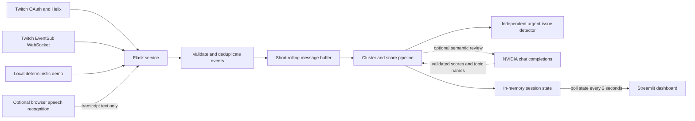

# ChatSense

**ChatSense is an AI co-host for Twitch streamers.** It watches the flow of chat and lifts a small number of potentially useful items—stream-impacting issues, activity-relevant questions, and community insights—into an explainable attention queue. It is designed to reduce the effort of scanning a fast chat while leaving every decision to the streamer.

The project is a local hackathon application built from a Streamlit dashboard and a small Flask service. It includes a deterministic demo that needs no Twitch or model credentials, a read-only live chat integration, optional NVIDIA semantic analysis, and optional browser speech context.

## What problem it solves

During a live broadcast, a streamer may be playing a game, teaching, or talking while chat moves quickly. A chronological message feed makes it easy to miss a technical problem, a thoughtful question, or a useful idea. ChatSense turns that feed into a compact, prioritized view:

- **Live Issue** surfaces reports that may affect the broadcast, such as microphone echo, delayed audio, or a frozen video. Issue detection is independent from ordinary comment scoring so a possible stream problem does not disappear below a high-scoring question.
- **Best Question** favors clear questions that make sense for the current activity. Being phrased as a question is not enough: relevance and quality must pass a threshold before it becomes an unanswered-question recommendation.
- **Community Insight** groups useful suggestions and shared observations. A rolling community pulse summarizes the topics viewers are discussing.
- **Suggested streamer action** turns the strongest current signal into a short, optional next step. It does not answer on the streamer's behalf.

The dashboard shows representative text, supporting messages, distinct viewer counts where relevant, score signals, and a plain-language reason. The streamer can pin, dismiss, defer, mark answered, or mark an item not relevant. Those choices shape the current session and can be reset.

ChatSense does not analyze the video. It uses chat text, Twitch stream metadata, activity selected by the streamer, optional free-text context, and—if enabled—browser-generated transcript text.

## Architecture



### Dashboard: `streamlit_app.py`

Streamlit renders the dashboard, context controls, live preview, attention queue, recent chat, community pulse, and feedback controls. It polls the Flask state endpoint using a short Streamlit fragment refresh. The responsive layout stacks the preview and ranking panels at narrower widths. The speech control uses browser `getUserMedia` and the browser's SpeechRecognition implementation when available.

### Backend: `app.py`

Flask owns Twitch OAuth, API calls, the EventSub WebSocket lifecycle, message processing, optional NVIDIA requests, and one in-memory session. Twitch tokens and client secrets stay on the backend. The backend exposes JSON state/control endpoints and an SSE endpoint; the current Streamlit UI reads state by polling.

Incoming messages are validated, deduplicated by event ID, bounded in memory, and collected into short batches. A recurring timer processes a batch so the application does not wait for an analysis request on every message. Similar technical reports are grouped by issue type, and the viewer set is used to count independent reports instead of counting repeated messages from the same person as corroboration.

### Chat inputs

- **Demo Mode:** `app.py` plays a deterministic sequence containing a meme burst, a relevant question, audio reports, and repeated suggestions. It is explicitly marked as simulated and enters the same classification, scoring, queue, and UI pipeline as live messages. It does not require Twitch credentials.
- **Live Mode:** The broadcaster authorizes the app, and Flask subscribes to `channel.chat.message` over Twitch EventSub WebSockets. Connection, revocation, and reconnect states are exposed to the dashboard.
- **Twitch chat simulator (optional):** For an end-to-end integration check on a live broadcast, a separate bot account authorizes chat sending. Only when the streamer explicitly starts it, the simulator sends its selected sample messages using Twitch's Send Chat Message API. EventSub must receive those messages before they enter the analysis path; they are not inserted directly into the pipeline. This is test traffic and is distinct from Demo Mode.

### Attention engine

1. **Classify:** Lightweight rules identify likely issues, questions, suggestions, reactions, and low-content repetition.
2. **Cluster and deduplicate:** Repeated or semantically similar technical complaints are combined into one candidate with representative evidence and distinct-viewer counts. Incoming Twitch event IDs are deduplicated separately.
3. **Score:** The initial weighted score is `0.35R + 0.25Q + 0.20N + 0.20U`, where each value is clamped to the range 0–1:
   - **R — Relevance:** Fit with the stream activity, title/category, context, and optional recent transcript.
   - **Q — Quality:** Clarity and potential value of a question or contribution.
   - **N — Novelty:** Whether it adds information beyond recent chat.
   - **U — Usefulness:** Potential value or urgency to the streamer.

   Weights are adjustable in Advanced settings. Displayed percentages are ranking signals, not objective truth.
4. **Detect urgent issues independently:** Explicit stream-impact symptoms (for example, mic echo or delayed audio) are eligible for immediate visibility. Other technical concerns can become urgent when several distinct viewers report them within the recent window. The UI labels these as *potential* issues, not confirmed faults.
5. **Optionally analyze semantically:** If `NVIDIA_API_KEY` is configured, eligible batches and recent community messages are sent to NVIDIA's chat-completions endpoint for context-aware relevance/quality scoring and topic naming. The prompt treats chat and transcript as untrusted data. The response is parsed and validated before it can update candidates. Requests run separately from message receipt; on timeout, missing credentials, or invalid output, deterministic scoring remains available.
6. **Select fresh candidates:** The compact queue prioritizes urgent items, keeps evidence available, and prunes stale unpinned items. Question recommendations additionally require relevance and score thresholds; unrelated questions should not trigger a suggested action merely because they contain a question mark.
7. **Learn from session feedback:** Dismissed/irrelevant/answered decisions suppress resurfacing for the session; pins are retained. Reset clears the learned session feedback.

### Optional speech context and privacy

Speech capture is opt-in. The streamer can start or stop it independently from the Twitch connection; while a live broadcast is observed, ChatSense stops the microphone when that broadcast ends. The browser captures microphone audio temporarily and sends it to the browser speech-recognition service through its Web Speech implementation; availability and audio processing depend on the browser. ChatSense does not write an audio file. Only finalized transcript text is sent to Flask and retained in the current in-memory session to influence later chat rankings. The browser speech service may process audio remotely, so this feature is not guaranteed to be local-only.

Raw chat, transcript, OAuth state, and feedback are held in process memory for this prototype; there is no database or durable chat archive. Restarting the backend clears that session state and its in-memory Twitch authorization.

## Run locally

Use Python 3.9 or newer. From the repository root:

```bash
python3 -m venv .venv
source .venv/bin/activate
python3 -m pip install -r requirements.txt
cp .env.example .env
```

Start Flask and Streamlit in separate terminals, both from the repository root and with the virtual environment activated:

```bash
python3 app.py
```

```bash
python3 -m streamlit run streamlit_app.py --server.port 8501
```

Open [http://localhost:8501](http://localhost:8501). The Flask service listens on port 3000 by default; opening [http://localhost:3000](http://localhost:3000) redirects to the Streamlit dashboard.

### Environment variables

The checked-in `.env.example` lists the supported variables. Put real credentials in an untracked `.env` file; never commit them.

| Variable | Required for | Notes |
| --- | --- | --- |
| `TWITCH_CLIENT_ID` | Live Twitch OAuth | Twitch developer application client ID. |
| `TWITCH_CLIENT_SECRET` | Live Twitch OAuth | Backend only; never put it in browser code. |
| `TWITCH_REDIRECT_URI` | Live Twitch OAuth | Must exactly match the callback URL registered in Twitch, normally `http://localhost:3000/auth/twitch/callback`. |
| `NVIDIA_API_KEY` | NVIDIA semantic ranking and topic labels | Optional. Deterministic ranking continues when absent or unavailable. Store the key without a literal `Bearer ` prefix; the backend adds the authorization scheme. |
| `PORT` | Flask listener | Optional; defaults to `3000`. The redirect URI must use the same port. |
| `CHAT_SENSE_API_URL` | Streamlit to Flask | Optional; defaults to `http://localhost:3000`. |
| `CHAT_SENSE_UI_URL` | OAuth callback redirect | Optional; defaults to `http://localhost:8501`. |
| `STREAMLIT_ALLOWED_ORIGINS` | Browser transcript CORS | Comma-separated local Streamlit origins; defaults to localhost and 127.0.0.1 on port 8501. |

### Twitch developer setup for Live Mode

1. Create a Twitch developer application and set its OAuth redirect URL to the exact value in `TWITCH_REDIRECT_URI`.
2. Add the application client ID and client secret to `.env`.
3. Start both services and choose **Go Live / Connect Twitch** in the dashboard. The broadcaster account grants `user:read:chat` for reading chat events.
4. Start your broadcast externally. The dashboard checks live state through Twitch and displays the channel preview when live.
5. To exercise the optional API simulator, connect a different Twitch account as the bot from **Test chat simulator**. It grants `user:write:chat`. Select message types and a cadence, then explicitly start the simulator while the broadcaster is live and EventSub is connected.

The regular Live Mode dashboard is read-only with respect to chat. Only the explicit simulator path posts its canned test comments. ChatSense never generates replies, moderates, deletes, or bans users.

## Dashboard controls

- **Stream context:** title, category, current activity, and a free-text note used to judge relevance.
- **Start / pause / resume / stop demo:** controls for sample traffic. Demo Mode is always labeled as simulated.
- **Attention cards:** inspect evidence and score components; pin, mark answered, defer, dismiss, or mark not relevant.
- **Community pulse / unanswered questions:** view recurring audience themes and fresh, relevant unanswered questions.
- **Advanced settings:** adjust the four scoring weights and analysis interval, inspect feedback totals, pause/resume analysis, or reset session preferences.
- **Speech context:** optionally begin or stop browser microphone transcription; if a live stream is detected, capture stops when that stream ends.
- **Test chat simulator:** optionally configure API-sent bot test traffic for an end-to-end Twitch integration check.

## Tests

The repository includes deterministic pipeline, Flask integration, and Streamlit rendering tests. Run them with:

```bash
python3 -m pytest
```

They cover activity-aware ranking, question-versus-meme ordering, issue grouping and distinct viewers, urgency, feedback/pinning, NVIDIA fallback, OAuth and API behavior, demo mode, and dashboard rendering. A passing local test suite does not verify Twitch OAuth, EventSub delivery, a live broadcast, browser speech recognition, or external NVIDIA availability; those require the relevant account, network, browser, and credentials.

## Current scope and limitations

- This is a single-process prototype with one in-memory session, intended for local hackathon demos. It is not multi-user or horizontally scalable.
- Twitch tokens and session state are memory-only and disappear on backend restart; reconnect after restart.
- EventSub and the NVIDIA endpoint require internet connectivity and may be unavailable or rate-limited.
- Browser speech recognition varies by browser and may use a remote browser-vendor service. Only transcript text is sent to ChatSense; do not assume speech audio stays on-device.
- The heuristic fallback is deliberately lightweight. Activity-domain vocabularies are not a substitute for semantic analysis, and model scores are recommendations for human review.
- The Twitch Send Chat Message simulator requires a distinct bot account and a live channel. It is optional and is not needed to demonstrate Demo Mode.
